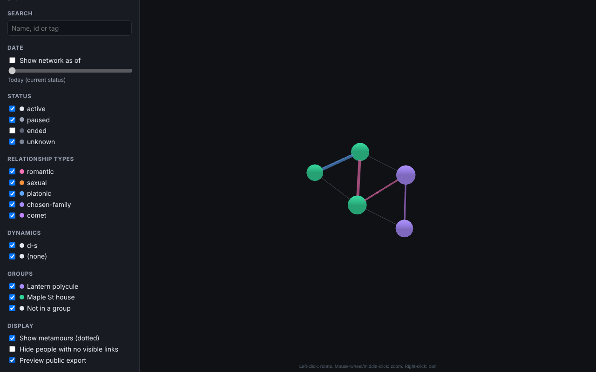

# polyML

polyML is an open, privacy-first format for describing relationship networks: the people in them, the groups they form (houses, pods, polycules, families), and the relationships between them. It also covers how those relationships change over time.

- **Spec:** [`spec/polyml-spec.md`](spec/polyml-spec.md), v0.1 draft, with a JSON Schema at [`spec/polyml.schema.json`](spec/polyml.schema.json)
- **3D viewer:** [`viewer/`](viewer/), a static web page built on [3d-force-graph](https://github.com/vasturiano/3d-force-graph). It's published to GitHub Pages. Files you open are read in your browser and never uploaded.
- **Python library and CLI:** [`python/`](python/) provides `polyml validate`, `polyml stats`, and `polyml export --public`.
- **Legacy:** [`legacy/powershell/`](legacy/powershell/) holds the original 2016 PowerShell class library (spec v0.0). Spec §6 shows how it maps to v0.1.



## Quick start

```sh
cd python
pip install -e ".[dev]"
polyml validate ../spec/examples/sample.polyml.json
pytest
```

To view your own network, open the viewer and use **Open file…** or drag a `.polyml.json` file onto the graph. Before sharing a file, run `polyml export --public` to drop private people and relationships and mask redacted names.

## Privacy

`.gitignore` excludes every `*.polyml.json` except the fictional samples, so a real network can't be committed by accident.
